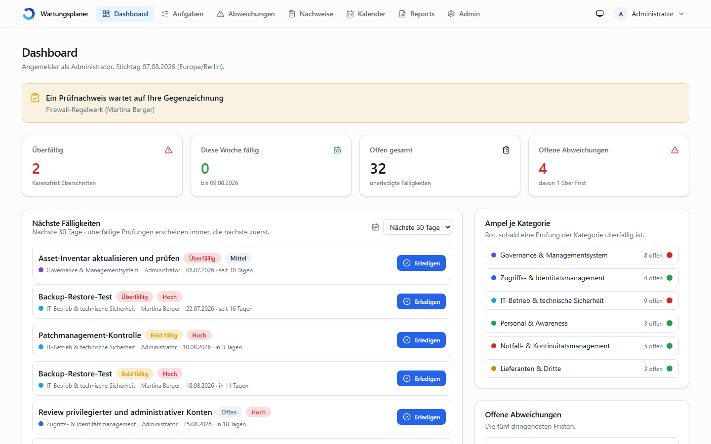

# Wartungsplaner – recurring IT audit tasks with tamper-evident records

_[Deutsche Fassung](README.md) · the application itself is German-only, see
[Language](#language)._

A self-hosted web application for planning recurring IT audit and maintenance
tasks — restore tests, access and physical-entry reviews, patch-status checks,
the annual UPS test — and for producing the records an auditor asks for.

It generates due dates from the intervals you configure, records every
execution immutably with file evidence and a SHA-256 checksum, tracks findings
through to closure, and produces audit-ready reports as PDF and Excel.



---

## Why this exists

Most teams track this in a spreadsheet. That works until someone asks _when_
the restore test was last run, _who_ signed it off and _where_ the evidence
is. This application answers those three questions by construction:

- **Every execution is immutable.** Corrections are new, logged events — the
  original stays. A database trigger enforces the same rule on the audit log:
  inserts only, no updates, no deletes.
- **Evidence carries a checksum.** A nightly run verifies every stored file
  against its SHA-256 in both directions, so silent loss surfaces while it can
  still be fixed.
- **Four-eyes review where it matters.** Structured checklists can require a
  second person to counter-sign; the resulting PDF names both.

## What it does

| Area                   |                                                                                                                                         |
| ---------------------- | --------------------------------------------------------------------------------------------------------------------------------------- |
| **Scheduling**         | Daily to annual intervals plus "every N days", fixed rhythm or relative to completion, lead time and grace days per task                |
| **Execution**          | Result, comment, file evidence, findings with severity, owner and deadline                                                              |
| **Checklists**         | Reusable templates, per-row decisions imported from CSV (e.g. an AD export), optional four-eyes counter-signature, generated PDF record |
| **Findings**           | Tracked from open to closed, with reminders before the deadline                                                                         |
| **Reports**            | Compliance overview, execution history, open findings, forecast, evidence register — as PDF and Excel, with configurable templates      |
| **Evidence integrity** | Nightly checksum run, ZIP export with a `sha256sum`-compatible list, retention periods that delete the file but keep the record         |
| **Notifications**      | Digest e-mails per person, escalation, weekly summary, deputy handling during absence                                                   |
| **Calendar**           | An iCal feed per person that Outlook subscribes to                                                                                      |
| **Sign-in**            | Local accounts, passkeys (WebAuthn), optional OIDC single sign-on                                                                       |
| **Audit log**          | Append-only, enforced in the database                                                                                                   |

## Quick start

Requires Docker and Docker Compose — nothing else.

```bash
git clone https://github.com/<account>/wartungsplaner.git
cd wartungsplaner

cp .env.example .env
# set AUTH_SECRET, POSTGRES_PASSWORD and SEED_ADMIN_PASSWORD

docker compose up -d --build
```

Then open <http://localhost:3000> and sign in with the seeded administrator.
The database schema is applied automatically.

**A fresh installation is empty** — the seed creates the administrator
account and nothing else. Which checks run at which interval is your
organisation's decision, not the application's. A ready-made starting set
covering ISO/IEC 27001:2022 and TISAX (VDA ISA 6) ships in
[`beispiele/pruefplan/`](beispiele/pruefplan/) and is imported on demand via
_Administration → Import und Export_: 6 categories, 49 audit references, 30
recurring checks with instructions, 9 checklists. The files are German, as
is everything else — see below.

Full installation, configuration and operations guide (in German):
[README.md](README.md).

## Language

**The user interface, the handbook and the reports are German only.** This is
deliberate: the application is used by German IT teams and audited against
German-language documentation. There is no i18n layer, so adding a language
means more than translating strings.

The code, comments and commit messages are German as well. If you want to
adapt it, expect to read German.

## Technology

Next.js 16 (App Router) · React 19 · TypeScript · PostgreSQL 16 with Prisma ·
Auth.js · pdfkit · exceljs · Tailwind CSS. Runs as a two-container Docker
Compose stack.

## Testing

| Command                    |                                                           |
| -------------------------- | --------------------------------------------------------- |
| `npm test`                 | 567 unit tests covering scheduling, dates, evidence rules |
| `npm run test:integration` | against a real PostgreSQL instance                        |
| `npm run test:e2e`         | Playwright, drives the running application                |
| `npm run test:migrationen` | applies all migrations to an empty database               |
| `npm run test:ausgabe`     | generates Excel, ZIP and PDF and reads them back          |
| `npm run pruefen`          | formatting, lint rules, types and unit tests in one go    |

## Status and support

Used in production by a small IT team since 2026. Development follows
[ROADMAP.md](ROADMAP.md); changes are documented in
[CHANGELOG.md](CHANGELOG.md).

This is a spare-time project. Issues and pull requests are welcome, but there
is no promised response time and no support commitment. Security reports:
please use GitHub's private advisory function rather than a public issue —
details in [SICHERHEIT.md](SICHERHEIT.md).

## License

[MIT](LICENSE) — Copyright (c) 2026 Florian Wilde IT SysOp.

Use it, change it, ship it, including commercially. The only condition is
that the licence text and copyright notice travel with it. No warranty.
